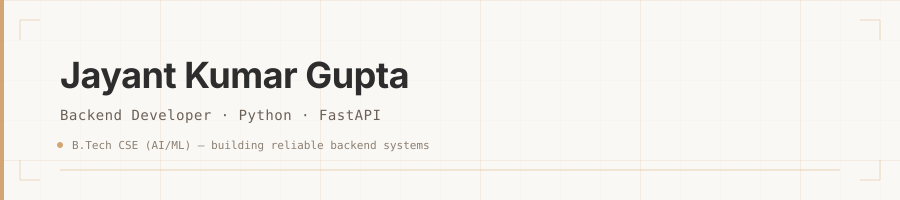

<picture>
  <source media="(prefers-color-scheme: dark)" srcset="https://github.com/jayant-kumar-gupta/jayant-kumar-gupta/raw/main/assets/hero-dark.svg">
  
</picture>

&nbsp;

B.Tech Computer Science student with a focus on backend engineering. I work with Python and FastAPI to build server-side applications — REST APIs, database-backed services, authentication systems. My approach leans toward getting the fundamentals right: clean data models, well-structured endpoints, and code that's straightforward to reason about.

Currently deepening my understanding of API architecture, database design, and system design. My longer-term interest is in AI engineering — particularly Generative AI and LLMs — but right now I'm focused on building strong software development and backend foundations first.

&nbsp;

### What I Work With

**Backend & Data**

**Frontend & Tools**

### What I Focus On

- REST API design and implementation
- Database modeling with SQLModel and PostgreSQL
- Authentication — JWT, Argon2, OTP flows
- Data Structures and Algorithms
- Writing backend code that's clear and maintainable

**Currently exploring**

- MongoDB and NoSQL patterns
- System Design fundamentals

&nbsp;

### Recent Work

**[DealBridge](https://github.com/jayant-kumar-gupta/DealBridge)** — A full-stack e-commerce price comparison platform. The backend handles JWT authentication with OTP verification, role-based access control, a multi-partner pricing engine, and a RESTful API built with FastAPI, SQLModel, and PostgreSQL. Frontend in vanilla HTML/CSS/JS. Deployed on Render.

  &nbsp;
  

&nbsp;

  
📊 GitHub Stats

   
  <picture>
    <source media="(prefers-color-scheme: dark)" srcset="https://github-readme-stats-fast.vercel.app/api?username=jayant-kumar-gupta&show_icons=true&hide_border=true&theme=transparent&icon_color=D4A574&title_color=E8E4DF&text_color=9B9188">
    
  </picture>
  <picture>
    <source media="(prefers-color-scheme: dark)" srcset="https://github-readme-stats-fast.vercel.app/api/top-langs/?username=jayant-kumar-gupta&layout=compact&hide_border=true&theme=transparent&title_color=E8E4DF&text_color=9B9188">
    
  </picture>

&nbsp;

---

  &nbsp;
  &nbsp;
  

